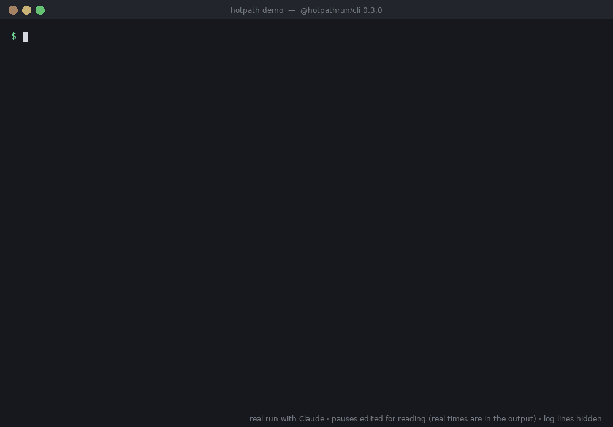

# Hotpath

**A just-in-time compiler for AI agents.**

Hotpath watches your agent run, finds the paths it repeats, and compiles them into a plain workflow you can read: the tool calls become code, and a model is called only for the text that needs judgment. When a tool changes shape, the run is handed back to your agent, which records the new path.

**New here? Read [Hotpath, explained](docs/HOTPATH-EXPLAINED.md)**: what it does and what it saves in plain English, how it works for developers, and a prompt that asks your coding agent whether Hotpath fits your project.



- **Cheaper.** A replay on Claude Haiku costs about 30–65× less than the Sonnet agent it replaced (two tasks, 10 runs each).
- **Faster.** Up to 8× faster on repeated data and about 2.5× faster on new data (two tasks, Claude, 10 runs each). The model call is most of the remaining time.
- **Checked.** Every report is checked against the data before it is sent. Sums, counts and currency and time-zone conversions are recomputed by code, not by the model. The replay noticed 8 of 8 kinds of data change we tested and handed the run to the agent instead of guessing.
- **Safe to retry.** A run that crashes between two actions does not repeat the first one when run again.
- **Local first.** It works on a free local model (Ollama). Your data, prompts and tool arguments stay on your machine; the only network calls are to the model provider you choose and, for your account, the run summaries described in [Optional: the dashboard](#optional-the-dashboard), and only if you sign in.

These numbers come from synthetic benchmark tasks; the runs, models and failures are published in [`docs/BENCHMARK.md`](docs/BENCHMARK.md). On a small free 1.7B model doing everything, 54% of 99 suite runs passed (87% where the recording was good): a replay is only as good as its recording, so record with a capable agent.

## Ten-minute quickstart

You need Node 22 or newer and one model: [Ollama](https://ollama.com) (free, local) or any OpenAI-compatible API key.

```bash
ollama pull qwen3:1.7b          # skip this if you use an API key
mkdir hotpath-try && cd hotpath-try
npx @hotpathrun/cli init           # pick Ollama or a provider; writes .env here
npx @hotpathrun/cli demo           # the one-command trial, explained below
```

No account needed: everything runs on your machine.

`init --provider ollama --yes` asks nothing and sets up Ollama. `hotpath demo` then does three things, and tells you which one it is on:

1. **Records.** The bundled demo agent does a "morning brief" task 3 times. Every tool call goes through the Hotpath recorder into `traces/`.
2. **Learns.** `hotpath learn` finds the path the agent repeated, compiles it into `workflows/`, and replays it on a recording as a shadow check before it goes live.
3. **Replays.** The compiled workflow runs on new data. The model is called for one step, the text of the brief; everything else is plain code. The demo tools are fake: the message goes to `out/messages.json`.

Then look at what it made. `demo` prints the name of the path it learned (like `path-0232bf65`):

```bash
npx @hotpathrun/cli show path-0232bf65     # the workflow as a list of steps
npx @hotpathrun/cli view path-0232bf65     # the same as a graph in your browser
```

On `qwen3:1.7b` the whole demo takes under a minute.

The demo needs a model that can call tools. `qwen3:1.7b` is enough for it; if a small model skips a tool call, the 3 runs differ and `learn` says so. Run `hotpath demo` again, or pick a stronger model for the agent in `init`.

To keep the command around: `npm i -g @hotpathrun/cli`, then `hotpath demo` and `hotpath --help`.

## Optional: the dashboard

The CLI runs without an account. Sign in with `npx @hotpathrun/cli login` (it shows a code and opens hotpath.run so you can approve it, once per computer) and your workflows and runs show on a free dashboard: hit rate, time and cost saved, and what fell back to the agent.

- **Only run summaries are synced, never your data.** What is sent: a workflow's name, its step counts and a graph of tool names and step kinds, and per run the time, cost, number of model calls and whether it fell back. Never tool arguments or results, prompts, model output, inputs, file paths or `.env` values.
- **Nothing is synced unless you sign in.** Signed in, turn sync off with `HOTPATH_NO_SYNC=1`.
- **In CI,** create a token under Settings → CLI sessions on the dashboard and set `HOTPATH_TOKEN`; no login step is needed.
- `hotpath whoami` shows who you are signed in as, `hotpath logout` signs this computer out and revokes its session. The sign-in is kept in `credentials.json` in your settings folder (`%APPDATA%\hotpath` on Windows, `~/.config/hotpath` elsewhere), readable only by you; it is checked online at most once a day, and the CLI keeps working offline for up to 7 days.

## Try it in Claude Code

The same demo, with Claude Code as the agent. The tools are fake (emails, calendar and weather from bundled files), so nothing real is read or sent. In the `hotpath-try` folder from the quickstart:

```bash
claude mcp add hotpath-demo -- npx -y @hotpathrun/cli record --task morning-brief -- npx -y @hotpathrun/cli demo-tools
claude
```

On Windows (not WSL), start the server through `cmd /c`: `claude mcp add hotpath-demo -- cmd /c npx -y @hotpathrun/cli record --task morning-brief -- npx -y @hotpathrun/cli demo-tools`.

Then ask the same thing three times, each in a new conversation (`/clear`), with a different date:

> Use the hotpath-demo tools: get my emails, calendar and the weather in Paris for 2026-10-01, then send me a short morning brief with send_message to "me".

Use 2026-10-02 and 2026-10-03 for the next two. Each run is recorded into `traces/morning-brief/`. Then:

```bash
npx @hotpathrun/cli learn                          # lists the path Claude repeated, with its name
npx @hotpathrun/cli learn --promote <path>         # shadow check, then it goes live
npx @hotpathrun/cli run <path> --input date=2026-10-05
```

The last command does the task with no agent: the tool calls are plain code, and your model from `init` writes only the text of the brief. The "sent" message is in `out/messages.json`. To remove the demo server: `claude mcp remove hotpath-demo`.

## Connect your own agent

Pick the one that matches how your agent calls tools.

**1. The model proxy: change one line.** Point your agent's model base URL at `hotpath proxy`. Nothing else changes: not the tools, not the loop, not the framework. Conversations are recorded, and repeated ones are served from compiled paths.

```bash
hotpath proxy --openai http://localhost:11434/v1 --read-only get_orders
```

```ts
const client = new OpenAI({ baseURL: "http://127.0.0.1:8787/v1", apiKey }); // the one line
```

It speaks the OpenAI Chat Completions and the Anthropic Messages APIs. See [`docs/PROXY.md`](docs/PROXY.md).

**2. MCP servers: `hotpath record` or `hotpath wrap`.** If your agent talks to MCP servers over stdio, put the recorder in front of one. For Claude Code, Cursor, Claude Desktop, VS Code and OpenClaw, `wrap` edits the agent's own config for you (and `unwrap` puts it back):

```bash
hotpath wrap claude-code gmail --task inbox-triage    # --dry-run shows the change first
hotpath record --task inbox-triage -- npx -y @acme/inbox-mcp-server   # or by hand
```

Do the task as usual a few times, then `hotpath learn` (or `hotpath compile inbox-triage` for one recording), `hotpath run inbox-triage --dry-run`, and `hotpath schedule add` to run it on its own. See [`docs/INTEGRATIONS.md`](docs/INTEGRATIONS.md).

**3. No MCP: the SDK.** If your tools are functions in your own code, `@hotpathrun/sdk` records and replays them in process. See [`docs/SDK.md`](docs/SDK.md).

## What is open and what is paid

Everything on one machine is open source under Apache-2.0: the recorder, compiler, runtime, CLI, SDK, the model proxy, `hotpath learn` over your local traces, the viewer, the local scheduler, the benchmarks, the examples and the docs. There is no licence key and no limit.

We plan to sell the layer a team needs to run this in production across many agents and people: fleet-wide auto-compile, a hosted proxy, tool-change alerts, a team dashboard, audit and SSO, and a shared library of compiled paths. **That layer is not available yet.** Details and the reasoning: [`docs/OPEN-SOURCE.md`](docs/OPEN-SOURCE.md).

## How it works

1. **Record.** The recorder, the proxy or the SDK writes each run as a trace: every tool call, its arguments, its result.
2. **Compile.** A deterministic compiler turns repeated traces into a workflow: tool steps, the values that change between runs as inputs, and short model steps only where the recording shows free-form text.
3. **Replay.** The runtime runs the workflow. Guards check the tool results and the written text. Side effects are never repeated, and `--dry-run` shows what would be sent.
4. **Drift.** If a result no longer has the shape the workflow expects, the run falls back to your agent, records that run, and the next compile learns it.

The data formats and design are in [`docs/SPEC.md`](docs/SPEC.md).

## Packages

| Package                                                                                 | What                                                            |
| --------------------------------------------------------------------------------------- | --------------------------------------------------------------- |
| `@hotpathrun/cli`                                                                       | The `hotpath` command                                           |
| `@hotpathrun/sdk`                                                                       | Record and replay agents whose tools are functions in your code |
| `@hotpathrun/proxy`                                                                     | The model proxy                                                 |
| `@hotpathrun/recorder`, `compiler`, `runtime`, `learn`, `scheduler`, `viewer`, `shared` | The engine's parts, published so you can build on them          |

## Develop

```bash
git clone <this repository> && cd hotpath
pnpm install
pnpm -r build && pnpm -r test && pnpm lint
```

See [`CONTRIBUTING.md`](CONTRIBUTING.md). Report a vulnerability privately as described in [`SECURITY.md`](SECURITY.md). Hotpath is licensed under the [Apache License 2.0](LICENSE).
