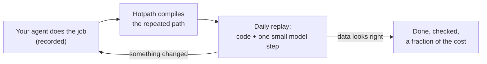
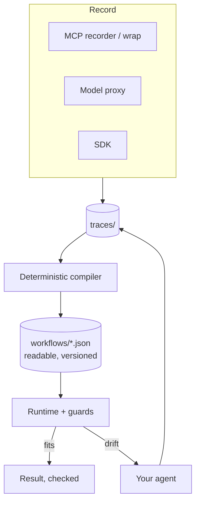

# Hotpath, explained

**Your AI agent does a job once. Hotpath runs it every day after, as checked code, for a fraction of the model cost.**

This page is for everyone: the first half is plain English, the second half is for developers. Hotpath is free and open source (Apache-2.0), runs on your own machine, and needs no account.

- [The problem](#the-problem)
- [What Hotpath does](#what-hotpath-does)
- [What it saves](#what-it-saves)
- [Can I trust it?](#can-i-trust-it)
- [Is it a fit for me?](#is-it-a-fit-for-me)
- [For developers: how it works](#for-developers-how-it-works)
- [Try it in ten minutes](#try-it-in-ten-minutes)
- [Questions](#questions)

---

## The problem

More and more teams use AI agents for jobs they do every day: writing the morning report, sorting the support inbox, checking invoices against payments, posting the weekly numbers.

The agent does these jobs well. But it does them **from scratch every time**. Every morning it thinks again about which tools to call, in which order, and what to do with the results, even though the answer is the same as yesterday. You pay a frontier model for that thinking on every single run.

Most of that bill pays for re-thinking. Very little of it pays for real work.

## What Hotpath does

Think of a new employee doing a task for the first time. They work it out, then write down the steps. From then on they follow the checklist, use their judgment only where it is needed, and ask their manager when something unusual happens.

Hotpath does that for your agent:

1. **It watches.** Your agent does the job as usual. Hotpath records every tool call it makes.
2. **It learns the path.** When the agent repeats the same steps, Hotpath compiles them into a short workflow you can read: get the emails, get the calendar, filter, write the summary, send it.
3. **It replays.** The next day, the workflow runs on its own. The tool calls are plain code. A model is called only where judgment is really needed, like writing the text of the summary, and a small, cheap or even local model is enough for that.
4. **It hands back when unsure.** If today's data does not look like what it learned (a field is missing, a tool changed, a case it never saw), the run stops before doing anything and hands the job back to your agent. The agent's run is recorded, and the workflow learns the new case.



## What it saves

Measured on our own benchmark tasks (synthetic data, small samples; every run and every failure is published in [`BENCHMARK.md`](BENCHMARK.md)):

|                                                          | Your agent, every run | Hotpath replay         |
| -------------------------------------------------------- | --------------------- | ---------------------- |
| Model cost per run (Claude, morning brief, 10 runs each) | $0.0179 (Sonnet)      | $0.0006 (Haiku)        |
| Model cost, two tasks                                    | 1×                    | about **30–60× lower** |
| Speed on new data                                        | 1×                    | about 2.5× faster      |
| Model cost on a local model (Ollama)                     | –                     | **$0** in API fees     |

What that means for a bill: if a job runs 1,000 times a day, the Sonnet agent costs about $537 a month and the replay about $18 (or about $71 if one run in ten has to go back to the agent). Your jobs will differ: measure one before you trust any number, including ours.

**Where it does not help:** jobs that are different every time (open research, one-off questions). Hotpath saves money on the part of your agent's work that repeats.

## Can I trust it?

Cheap is useless if it is wrong. Most of Hotpath is about not being wrong:

- **It says when it is not sure.** A run whose data does not fit stops before calling any tool and goes back to your agent. On our 11-workflow benchmark, replays on a free model got 43 of 44 runs right; the one left over handed back to the agent instead of acting.
- **Numbers are computed, not guessed.** Totals, counts, the top item, currency and time-zone conversions are worked out by code on each day's data, and the written report has to match them.
- **You approve it first.** `hotpath compile` shows what the recorded run did and asks if it is right. A workflow nobody confirmed does not run on its own.
- **No double actions.** A run that crashes between two actions does not repeat the first one when you run it again. `--dry-run` shows what would be sent without sending it.
- **Your data stays on your machine.** Without an account nothing leaves your computer except the calls to the model provider you chose. If you sign in for the optional dashboard, only run summaries are sent (workflow names, step counts, time, cost, fallbacks), never your prompts, inputs or tool results.

Honest limits: a replay is only as good as its recording, so record with a capable agent. On a small free 1.7B model doing everything, recording included, 54% of 99 runs passed (87% where the recording was good).

## Is it a fit for me?

You are a good fit if:

- an agent of yours does **the same kind of job** every day or every hour,
- it reaches its tools through **MCP**, an OpenAI or Anthropic API you can point elsewhere, or functions in your own code,
- the model bill for that job matters to you.

**Ask your coding agent.** Open Claude Code, Codex or Cursor in your agent's repository and paste this:

```text
Read https://github.com/hotpath-run/hotpath/blob/main/docs/HOTPATH-EXPLAINED.md.
Then look at this repository and tell me:
1. Which tasks does my agent run repeatedly with the same sequence of tool calls, how often, and on which model?
2. Roughly what share of my agent's model cost those repeated runs are.
3. Whether Hotpath would fit them, and which way to connect it (MCP recorder, model proxy or SDK).
If there are trace exports (OpenTelemetry, LangSmith or Langfuse), run `npx @hotpathrun/cli scan <file>` on them for an estimate.
Do not change any code.
```

**Or measure it yourself.** If you already export traces, `npx @hotpathrun/cli scan` reads them on your machine and shows which runs repeat and what you would save, without sending anything anywhere. See [`SCAN.md`](SCAN.md).

---

## For developers: how it works

Hotpath is a just-in-time compiler for agent runs, in TypeScript (Node 22+).

1. **Record.** Each run is written as a trace: every tool call, its arguments and its result. Three ways in:
   - **MCP:** `hotpath record` (or `hotpath wrap` for Claude Code, Cursor, Claude Desktop, VS Code, OpenClaw) sits in front of a stdio MCP server.
   - **Model proxy:** point your agent's base URL at `hotpath proxy` (OpenAI Chat Completions and Anthropic Messages). One line changes.
   - **SDK:** `@hotpathrun/sdk` records and replays tools that are functions in your own code.
2. **Compile.** A deterministic compiler (no model involved) turns repeated traces into a workflow: tool steps, the values that change between runs as inputs, decisions the recording shows a rule for (a lead's tier from its company size) as code, and short model steps only where the recording has free-form text.
3. **Replay.** The runtime runs the workflow on new data with a cheap or local model. Guards check each tool result's shape and the written text against the data. Side effects are never repeated.
4. **Drift.** When a result no longer has the expected shape, the run falls back to your agent, that run is recorded, and the next compile learns it.



A compiled workflow is a JSON file you can read, diff, review and commit. `hotpath show` lists its steps and `hotpath view` draws it as a graph.

Any OpenAI-compatible API works for the models, including Ollama on your own machine. The agent (used to record and on fallback) and the replay model are set separately.

**Where to read more:**

|                                       |                                                                                  |
| ------------------------------------- | -------------------------------------------------------------------------------- |
| Data formats and design               | [`SPEC.md`](SPEC.md)                                                             |
| Connect your agent                    | [`INTEGRATIONS.md`](INTEGRATIONS.md), [`PROXY.md`](PROXY.md), [`SDK.md`](SDK.md) |
| Run on a schedule, locally            | [`SCHEDULER.md`](SCHEDULER.md)                                                   |
| Every benchmark run and failure       | [`BENCHMARK.md`](BENCHMARK.md)                                                   |
| Security review                       | [`SECURITY-REVIEW.md`](SECURITY-REVIEW.md)                                       |
| What is open and what we plan to sell | [`OPEN-SOURCE.md`](OPEN-SOURCE.md)                                               |

## Try it in ten minutes

You need Node 22+ and one model: [Ollama](https://ollama.com) (free, local) or any OpenAI-compatible API key. No account.

```bash
mkdir hotpath-try && cd hotpath-try
npx @hotpathrun/cli init      # pick Ollama or a provider
npx @hotpathrun/cli demo      # records a demo agent 3 times, learns the path, replays it on new data
```

The demo's tools are fake (the "message" it sends is written to a file), so nothing real is read or sent. The [README](../README.md#ten-minute-quickstart) walks through what it prints, and how to run the same demo inside Claude Code.

## Questions

**Isn't this just caching?** Caching helps when the input is exactly the same. Hotpath compiles the steps, so a new day's data also skips the re-planning; only the judgment steps call a model.

**Why not write the script myself?** You can, for one job. Hotpath writes and checks it from a run your agent already did, keeps one per job, and notices when it goes stale.

**What if an API changes?** The run checks each result before the next step. If it no longer fits, it stops and hands over to your agent, which can record the new version.

**Does it lock me in?** No. It is Apache-2.0, the workflows are plain JSON files in your repo, and your agent keeps working without it.

**What does it cost?** Nothing. Everything that runs on your machine is free, with no run limit and no licence key. A hosted version for teams (running workflows for you, review and audit history, single sign-on) is planned and not available yet; see [hotpath.run/pricing](https://hotpath.run/pricing/).

**Who makes it?** Hotpath is built independently and in the open. Found a bug, or have a job you want to try it on? Open an [issue](https://github.com/hotpath-run/hotpath/issues) or write to us at [hotpath.run/contact](https://hotpath.run/contact/).
